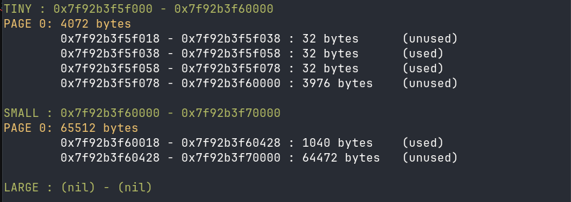
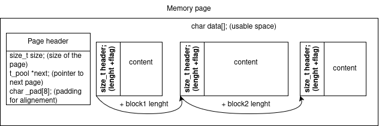

This project has been created as part of the 42 curriculum by maemaldo.

<h1>Malloc</h1>



<h2>Description</h2>

Malloc() is a memory allocator written in C, this project aim to replicate it's behaviour, 
alongside with it's same family functions free() and realloc().

This implementation uses mmap() (man 2) to create pools of memory, 
where it can easily handle memory allocation, de-allocation an re-allocation.

Inside of those "pools", memory blocks are created with a header pointing to the next block (linked list).
This method allow me to easily store the memory in a contiguous memory space with a dynamic sizing.



<h2>Instructions</h2>

To compile the library, simply use this commands:

```bash
make all # will compile libft and malloc
```

When the library is compiled, simply include ft_malloc.h in your program, and link it with it.

A test file is included, If you want to test my implementation, compile it with:

```bash
make test
```

and run:

```bash
./test
```

Feel free() to switch my libft with yours if you have one.

<h2>Resources</h2>

- 

<h5>AI USAGE</h5>

AI (gemini by Google, and MistralAI) was mostly used to check for errors, and occasionally to explain a few notions.No code was directly copy paste from the AI. This code is mine (written by me) and i understand it's content it perfectly.
